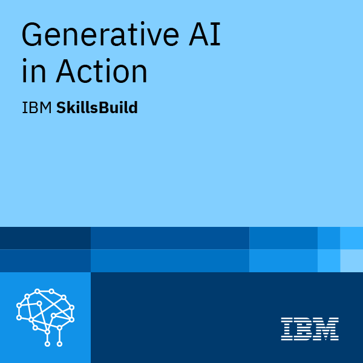

<h1 align="center">Ganath Avinash G R</h1>

  

## About

I am a third-year Computer Science student at Amrita Vishwa Vidyapeetham focused on full-stack software engineering and applied AI systems. My work centers on building scalable web applications, modern user interfaces, and task-specific AI agents that integrate into real-world workflows.

I am particularly interested in practical applications of language models, retrieval systems, backend engineering, and AI-driven automation. My goal is to build production-grade software that combines strong engineering principles with intelligent systems.

**Current areas of focus:**
- Full-stack application development
- AI agent architecture and orchestration
- Backend systems and API design
- Retrieval-Augmented Generation (RAG)
- Modern frontend engineering and responsive UI systems

## Tech Stack

  

## Coding Stats

  
  &nbsp;
  
  &nbsp;

  

## Badges

<table>
  <tr>
    <td align="center" width="150">
       
      <b>University Student</b> 
      Google Gemini
    </td>
    <td align="center" width="150">
       
      <b>Educator</b> 
      Google Gemini
    </td>
    <td align="center" width="150">
       
      <b>Gen AI in Action</b> 
      IBM
    </td>
  </tr>
</table>

## Projects

| Project | Description | Stack |
|---|---|---|
| [TrafficSense](https://github.com/Ganath-Avinash) | Real-time vehicle emission monitoring and visualization platform | Haskell, JavaScript |
| [RAG Customer Agent](https://github.com/Ganath-Avinash) | Retrieval-Augmented Generation based AI assistant for automated customer support workflows | Python, LangChain, RAG |
| [Portfolio Website](https://ganath-avinash.github.io/PortFolio_GR/) | Personal portfolio showcasing technical projects and engineering work | React, Tailwind CSS |
| [Wits & Bytes](https://github.com/Ganath-Avinash) | Wallpaper discovery and download platform with a responsive frontend and backend integration | React, Node.js, Express |

## Contribution Graph

  

  

## Contact

- **Email:** ganathavinash.gr@gmail.com
- **LinkedIn:** https://www.linkedin.com/in/ganath-avinash/
- **Portfolio:** https://ganath-avinash.github.io/PortFolio_GR/
- **LeetCode:** https://leetcode.com/Ganath

---

  Building production-focused software with modern engineering and applied AI.

